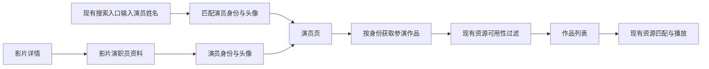

# 演员与参演作品技术方案

日期：2026-11-12

状态：共享实现完成；双端构建通过，Android 演员搜索／分类／返回流程验收通过

关联：[需求与验收](演员与参演作品-20261112.md)

## 接入前基线

| 源码 | 已确认事实 |
| --- | --- |
| [Models.kt](../../mobile/shared/src/commonMain/kotlin/dev/pandavideo/core/model/Models.kt) | `CatalogItem.casts` 是姓名列表；`SearchItem.cast` 是字符串；`PlaybackInfo` 没有演职员结构。 |
| [ContentRepository.kt](../../mobile/shared/src/commonMain/kotlin/dev/pandavideo/data/repository/ContentRepository.kt) | 目录来自豆瓣，当前浏览解析只保留前三个演员姓名。已有目录缓存、响应缓存、资源匹配与可用性过滤。 |
| [JianpianSource.kt](../../mobile/shared/src/commonMain/kotlin/dev/pandavideo/data/repository/JianpianSource.kt) | 搜索结果中的演员信息被解析成姓名文本，没有已验证的演员主页链路。 |
| [PomoSource.kt](../../mobile/shared/src/commonMain/kotlin/dev/pandavideo/data/repository/PomoSource.kt) | 搜索结果保留演员文本，没有已验证的唯一人物身份与作品接口。 |
| [ModernPlayer.kt](../../mobile/shared/src/commonMain/kotlin/dev/pandavideo/ui/player/ModernPlayer.kt) | `PlayerDetails` 是影片信息展示入口，可接演员列表；退出播放器已有会话收起逻辑，需要实际验证返回行为。 |

已查询仓库 Graphify 图并核对源码。以下是 2026-11-13 的真实公开访问结果，静态图不代替运行验证。

## 已验证的数据源与实施差异

- 豆瓣 `j/subject_suggest?q=成龙` 返回 HTTP 200，人物类型 `celebrity`、ID `1054531`、真实头像和英文姓名。刘德华、汤姆哈迪候选也返回结构化身份。
- 豆瓣影片演职员页、人物作品页返回 HTTP 403；不绕过限制，不采用这些页面。
- Wikidata MediaWiki API 返回 HTTP 200。`haswbstatement:P5284=1054531` 映射到成龙 `Q36970`；再次读取人物的 P5284 验证映射。P4529 对应豆瓣影片 ID。
- `haswbstatement:P161=Q36970` 返回明确演员作品关系，真实样本包括电影 `Q255342`（豆瓣 `1292624`，1998）及动画剧集 `Q777464`（成龙历险记）。同时收录 P725 配音关系；解析时再次核对非 deprecated 的实际声明。
- 设备验收发现文字 `OR` 合并属性查询返回成功的空结果；独立出演查询返回 130 条，明确包含 `Q777464`。实现分别请求 P161、P725 后按作品 ID 合并，作品缓存升级为 v2，避免复用该错误查询形成的空缓存。新增测试约束独立查询，并修正设备用例排除输入框、仅等待真实作品行。
- SPARQL 服务返回 429，使用公开 MediaWiki 索引查询；不重试受限服务。
- 每次最多查询 200 个关系条目。按 P31 / P279 的最多四层分类识别电影和电视剧，排除剧集单集、游戏、综艺等；未知类型不猜测。已识别作品按年份全局排序后，每 20 条展示。超过范围时页面明确标注。
- 详情页已有姓名不是完整演职员表。人物候选必须与当前影片的 P161 / P725 关系核对后才启用点击；无法确认时保留姓名图标。
- Wikidata 中文译名可能与豆瓣不同。可见作品通过建议接口核对同一豆瓣影片 ID 后采用本地标题和海报，再执行资源检查；无法核对的作品保留，提供普通片名搜索，不自动播放，也不据此认定无资源。
- 当前资料源未提供评分与简介，不编造。人像使用豆瓣真实头像，作品图片使用豆瓣或 Wikimedia Commons 的真实图片。

实现文件：`Actors.kt`、`ActorSource.kt`、`ActorBrowser.kt`、`ActorUi.kt`。仓库持有请求与七天缓存／三十天旧资料回退，Compose 页面持有分类、滚动位置及每页展示状态。人物搜索由独立控制器管理，取消旧请求后检查协程状态，影片搜索失败不清空人物结果。

## 数据源验证约束

原方案优先验证豆瓣影片演职员页面。真实访问受限后，改用上述结构化身份映射与声明核对；不能根据已有姓名列表推定存在稳定公开接口。

已核对电影、电视剧真实样本，以及演员唯一 ID、真实头像、出演关系和类型字段。解析测试补充同名人物、无头像、导演关系排除、类型继承、全局排序、覆盖范围、迟到响应与旧模型兼容。移动端实际流程与图片验证结果单独记录。

未通过验证时，保留已有姓名展示，并记录具体限制；不能把普通片名搜索或演员姓名搜索冒充参演作品接口。其他结构化资料源作为备选，需要核实身份映射、访问条件与覆盖情况。没有现成的 TMDB 凭据或已接入能力，方案不假定其可直接使用。

客户端继续直连目录与播放源，不依赖 frontend/NAS 服务。验证码或访问限制按失败处理，不绕过验证，也不写入成功缓存。

## 模块与数据流

使用共享 KMP 模型、仓库与 Compose 页面。人物解析放到独立的数据源适配文件，避免继续扩张 `ContentRepository`；UI 不解析 HTML 或根据姓名自行猜测身份。具体接口名称在数据源验证后落定。

| 数据契约草案 | 必要字段与规则 |
| --- | --- |
| ActorRef | 来源、人物 ID、姓名、可缺失的真实头像 URL。身份键为来源与 ID，不能只用姓名。 |
| CastCredit | 明确影片身份、ActorRef、出演／配音关系、来源排序，可缺失的角色名。只有名字时保留不可导航条目。 |
| ActorProfile | ActorRef、可选简介、数据更新时间；简介缺失不阻塞作品浏览。 |
| ActorWork | 来源作品 ID、标题、类型、年份、海报、可选评分、出演关系。通过明确映射转换为现有目录模型。 |
| ActorFilmography（已实现） | 实际保存全局排序的有界作品快照、覆盖限制、缓存是否过期；页面按过滤后列表每 20 条展示。未知完整总量不填推断数字。 |

不同资料来源的同名作品不能直接合并。与播放目录映射优先明确 ID，否则校验标题、年份及类型；无法确定时保留未确认状态，不能因匹配网络失败删除。

## 状态、缓存与导航

- 演员资料与作品独立加载。头像、简介或后续页失败均不清空已显示作品。
- 现有搜索入口增加独立人物结果状态，共用同一个输入词。人物资料源先查询候选身份，再按用户选择的身份读取作品；播放源的文本搜索不能作为完整参演关系证明。人物与影片查询分别处理失败及取消，避免一类失败清空另一类结果。
- 缓存键区分人物建议、人物作品、影片出演关系及影片元数据，并包含来源版本与人物／作品 ID。全量有界快照不按本地类型和页码重复存储；复用现有响应缓存与清理入口。资料和作品缓存七天，失败时回退三十天内的旧资料并标记未更新。
- 取消过期请求，回传结果必须核对人物身份与过滤类型。快速点击不同演员、切换分类不能让迟到的响应覆盖当前页。
- 通过现有目录可用性机制剔除明确缺少资源的作品；不要等待所有资源检查完成才显示第一页。源分页是否结束与过滤后可见数量分别计算，过滤出空页不等于作品列表结束。
- 演员页作为可返回的浏览目的地，保存人物身份、类型和滚动位置。当前播放会话继续由原有播放器持有；打开新作品时才走现有更换播放流程。已有路由可见性控制负责暂停与恢复；实际播放进度返回需独立设备验收，不能仅以页面返回成功作为播放验证。
- `CatalogItem` 的既有 `casts` 字段保留兼容旧缓存。详细演职员数据独立缓存，不将头像和人物身份塞入旧姓名字符串。
- 人像使用资料来源的真实图片，缺失用原生人物图标；不生成演员肖像。沿用现有图片加载与缓存组件。

## 实施任务及完成条件

| 任务 | 关联需求 | 前置条件 | 完成与验证 |
| --- | --- | --- | --- |
| T-01 数据源样本与可用性验证 | ACT-01～04、07 | 无，可继续只读调查 | 记录真实访问结果与字段证据，确认身份、分页和覆盖范围；不能用静态猜测代替结果。 |
| T-02 结构化人物与作品数据、缓存 | ACT-02～04、08 | T-01，受影响方案已确认 | 解析样本测试覆盖同名、空字段、角色筛选、分页和旧缓存兼容；失败页面不进入成功缓存。 |
| T-03 演员卡片与演员页 | ACT-01、03、04、09、10 | Q-01、T-02 | Android / iOS 共用 UI；确认真实头像、缺图、长姓名、分类和加载状态。 |
| T-03a 按演员搜索 | ACT-02、11 | T-01 人物查询验证、T-02 | 在现有搜索入口显示人物结果，验证姓名查询、同名选择、人物查询失败及迟到响应；点击后进入正确的参演作品页。 |
| T-04 作品匹配与返回会话 | ACT-05～07 | T-02、T-03 | 验证已确认无资源过滤、未知保留、返回滚动位置与播放进度。 |
| T-05 双端验证与 QA 材料 | 全部 | T-02～04（含 T-03a） | 执行 mobile/AGENTS.md 要求的宿主测试、Android APK、iOS framework 构建，安装并启动可用实机，补齐流程证据；按根 AGENTS 刷新代码图。 |

验证重点：两个同名演员、影片与剧集分类、配音关系、来源只返回部分作品、快速切换与迟到响应、过滤后空页、分页失败重试、离线缓存、头像失败、返回原播放器。构建成功与演员身份准确、作品可播放分别记录。

本次已开始共享模型、数据、缓存、UI 与导航实施。构建与设备检查状态将在下方记录，源码实现不代表所有设备验收已完成。

## 2026-11-13 构建与测试记录

- 使用 `mobile/tools/feature-verification.init.gradle`，输出隔离在 `mobile/build/actors`，Native 使用 `.xcode.env` 已有的 `/tmp/nasvideo-konan`。
- `:shared:testAndroidHostTest`：22 套件、240 项，失败 0、错误 0。
- `:shared:jvmTest`：32 套件、283 项，其中 4 项未启用的线上探测跳过，失败 0、错误 0；包含演员离线快照、人物缓存不被验证码页面覆盖及缓存清理测试。
- `:app:assembleChinaDebug`、`:shared:linkDebugFrameworkIosSimulatorArm64`：成功。Android 编译现有 Media3 弃用警告与设备测试既有非空断言警告不属于本次演员逻辑。
- APK：`mobile/build/actors/app/outputs/apk/china/debug/pandavideo.apk`，已安装到 PICO B3110 并启动；首页出现「搜索影视或演员」。
- 现有手机 AVD 启动被本机 `HV_DENIED` 阻挡。PICO 空间窗口的普通坐标注入未触发应用点击，增加 opt-in `ActorNavigationDeviceTest`，通过无障碍动作直接验证搜索和筛选。首轮暴露上述合并查询问题，修复后重跑：`OK (1 test)`，21.926 秒。验证搜索成龙、真实演员卡片、参演作品行、电视剧中的《成龙历险记》、电影分类以及返回演员搜索结果。实际新作品播放及返回原播放器的进度恢复仍需独立验收。
- iOS 当前只完成共享 Framework 编译，尚未完成演员页面的 iOS 实际设备验收；需通过 Xcode 重新部署。
- 已刷新 Graphify 图、HTML 与报告。解析器对部分 Kotlin 文件保留覆盖警告，不能以代码图代替编译或运行证据。
