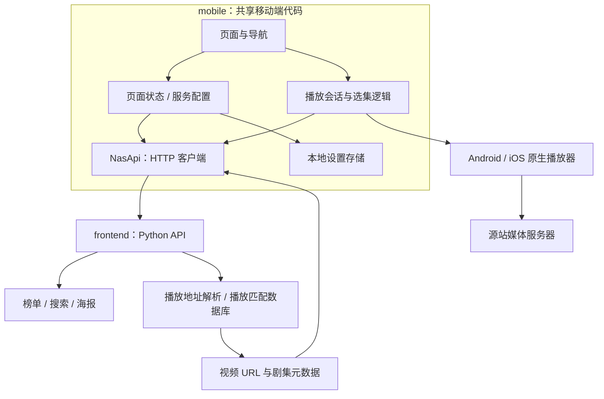
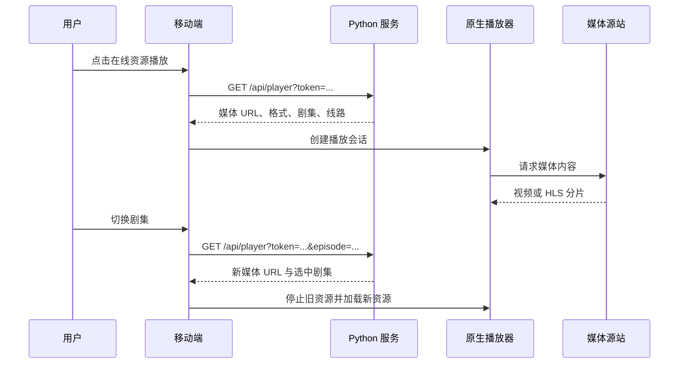

# PandaVideo Android / iOS 跨平台技术方案

状态：**历史方案，已被 KMP 方案替代，不再作为实现依据**

最新方案：[KMP + Compose Multiplatform 技术方案](KMP-Compose-Multiplatform技术方案.md)。

版本：v0.1  
日期：2026-11-09  
适用项目：PandaVideo

本文用于确认移动端技术选型、首版范围、与现有服务的交互方式及验收标准。文中的“建议”“拟采用”均属于待确认方案。

此前已生成一版初步移动端代码和依赖配置，但尚未生成并验证完整的 Android、iOS 原生构建。本次只编写方案；现有初步代码不作为已完成交付，确认后再根据最终方案调整和实现。

## 1. 目标与现状

目标是在 `mobile/` 中建立一个 Android 和 iOS 共用的跨平台应用，连接现有 PandaVideo 服务，提供适合手机操作的影视浏览、搜索与视频播放体验。

当前仓库已经划分为：

```text
PandaVideo/
├── frontend/    # 网页、Python Web 服务、资源解析与服务端测试
└── mobile/      # Android / iOS 跨平台工程
```

`frontend/` 包含配套 Python API，并非只有网页。现有服务已经具备豆瓣榜单、分类查询、聚合搜索、播放地址解析、海报代理缓存和下载链接获取能力，移动端可以直接复用。

**需要明确的产品边界：**当前服务主要提供外部影视来源的搜索与播放，NAS 用于服务部署和下载目录配置。现有 API 没有 NAS 私人媒体库扫描、SMB 文件浏览或本地文件串流能力。如果此次移动端需要播放 NAS 上已经存储的私人影片，需要补充媒体库与服务端串流方案，不能仅依靠现有接口实现。

## 2. 技术选型

### 2.1 候选方案

下表是针对本项目的工程判断，不代表经过实测的性能排名。

| 维度 | React Native + Expo | Flutter | WebView 包装现有网站 |
|---|---|---|---|
| 主要语言 | TypeScript / JavaScript | Dart | JavaScript，少量原生代码 |
| Android / iOS 共用 | 页面与业务逻辑共用，平台能力通过模块接入 | 页面与业务逻辑共用，平台能力通过插件接入 | 主要复用现有网页 |
| 与当前工程的关系 | 可沿用现有 JavaScript 技术栈与部分纯逻辑；DOM 和 CSS 不能直接复用 | 复用 HTTP API；移动端页面和客户端逻辑用 Dart 实现 | 页面复用直接，但交互仍以网页为主 |
| 视频播放 | 通过 `expo-video` 接入原生播放能力 | 通过 `video_player` 等插件接入平台播放能力 | 播放能力受 WebView 内核、平台媒体策略和桥接实现影响 |
| 后续平台扩展 | 可以增加 Kotlin / Swift 原生模块，需要评估 Expo 模块兼容性 | 可以增加平台插件与通道 | 需要为网页和原生桥接分别维护 |
| 适用条件 | 希望使用 TypeScript，共用移动端页面，并保留原生扩展能力 | 更偏好 Dart，或计划使用 Flutter 统一其他客户端 UI | 希望快速形成网站包装应用，且接受网页交互边界 |

### 2.2 推荐结论

**建议采用 React Native + Expo + TypeScript。**

主要理由是现有项目已使用 JavaScript，服务端接口也可以直接复用；移动端能够独立组织原生导航和视频播放页面，同时保留 Kotlin / Swift 扩展入口。选择 Expo 是为了统一依赖匹配、原生配置生成及双端开发流程。

Flutter 同样可以满足双端需求。如果后续目标是较大范围的统一自绘 UI，或团队更熟悉 Dart，可以在实施前切换为 Flutter。当前没有足够的实测数据证明两者在本应用上的播放性能差异，播放器能力需要通过设备测试确认。

### 2.3 建议技术栈

| 层次 | 建议方案 | 责任 |
|---|---|---|
| 应用框架 | React Native + Expo SDK 57 | 双端应用运行与依赖管理 |
| 语言 | TypeScript | 页面、业务模型与接口类型 |
| 导航 | Expo Router | 底部导航、播放页和返回行为 |
| 视频 | `expo-video` | 原生视频控制、事件和资源释放 |
| 网络 | `fetch` + `AbortController` | HTTP 请求、超时和取消 |
| 本地配置 | AsyncStorage | 保存服务地址等非敏感配置 |
| 页面状态 | React hooks + 小范围 Context | 请求状态与服务配置 |
| 原生配置 | Expo config plugins + prebuild | 生成 Android / iOS 工程与平台配置 |
| 构建分发 | 本地 Gradle / Xcode；按需使用 EAS | 开发、测试及正式构建 |

建议基线为 Expo SDK 57、React Native 0.86、React 19.2.3。具体补丁版本在实现阶段完成依赖兼容检查后，通过 lockfile 固定。

选择 SDK 57 的当前依据是本机已有 Android API 36，官方 SDK 57 支持表也使用 API 36；本次不以追随最新 SDK 为目标。后续升级以设备支持、插件兼容及发布要求为依据。

按官方 SDK 57 支持表，目标最低系统为 **Android 7+、iOS 16.4+**，开发环境要求 Node.js 22.13+、Xcode 26.4+。这些最低系统版本仍需用户确认；如果需要支持更早的 iOS，必须重新评估 SDK 基线。

## 3. 首版功能范围

### 3.1 页面

| 页面 | 首版内容 | 主要行为 |
|---|---|---|
| 发现 | Top 250、高分剧集、喜剧、动画、自然纪录片 | 切换榜单、分页、刷新、搜索资源或匹配播放 |
| 分类 | 类型、题材、年份、排序组合筛选 | 筛选后重置分页，加载更多作品 |
| 搜索 | 片名输入、全部/电影/电视剧、来源统计与结果 | 播放在线资源、复制下载链接、查看原站详情 |
| 播放 | 原生视频画面、线路、选集、倍速、全屏 | 重试、切换线路、同线路自动下一集 |
| 设置 | 服务地址、测试连接、服务状态 | 保存 NAS 地址，查看目录和服务配置状态 |

底部导航建议使用“发现、分类、搜索、设置”。播放页通过独立导航栈进入，不放入底部导航。

手机优先设计，同时支持横屏播放和平板列表布局。视觉建议沿用网站品牌，使用深色背景；具体样式在方案确认后再进入 UI 实现与审阅。

### 3.2 暂缓内容

首版建议暂缓账号登录、多 NAS 配置列表、收藏、跨设备观看进度、离线下载队列、电视端、Google Cast / AirPlay 集成，以及 NAS 私人媒体库扫描与 SMB 直连播放。

下载首版只提供“复制链接”，由用户选择下载工具。现有 `/api/download` 可能在服务端电脑唤起迅雷或向 MCP 设备提交任务，其行为与手机本地下载不同；若需要移动端直接提交下载，应单独确认目标设备、反馈方式和交互文案。

画中画建议作为首版可选项：启用后需验证两个平台的进入、退出和后台播放行为。普通后台切换默认暂停；画中画的后台行为应独立处理。

## 4. 总体架构与模块边界



服务端负责影视来源解析，移动端负责展示和播放。首版采用**服务端返回媒体地址、手机直接请求媒体服务器**的方式；现有服务不承担视频内容代理。

这意味着源站媒体地址必须对手机可达。如果视频访问依赖额外请求头、短期签名或特定网络环境，需要分别验证；如必须代理媒体内容，应另行设计支持 Range 请求和 HLS 分片转发的服务端能力。

建议目录：

```text
mobile/
├── src/
│   ├── app/                 # 路由页面和布局
│   │   ├── (tabs)/          # 发现、分类、搜索、设置
│   │   └── player.tsx
│   ├── components/          # 共用控件与列表
│   ├── lib/                 # API 客户端、接口模型、纯业务函数
│   └── state/               # 服务地址与本地配置
├── plugins/                 # 可重复生成的原生配置
├── assets/                  # 应用图标等资源
├── tests/                   # 契约和业务逻辑测试
├── docs/                    # 技术方案与后续验证记录
├── android/                 # prebuild 生成的 Android 工程
├── ios/                     # prebuild 生成的 iOS 工程
├── app.json
└── eas.json
```

模块约束：

- 页面不直接解析来源网站 HTML，也不保存来源站密钥。
- API 客户端统一构建请求、处理错误、检查响应结构，向页面返回业务模型。
- 服务地址是客户端实例的边界，搜索令牌只能用于签发它的服务。
- 播放会话管理媒体源、剧集和生命周期；视频组件管理原生播放器对象。
- 原生配置写入 `app.json` 和 config plugin，避免只在生成目录里修改，导致重新生成时丢失。

## 5. 与现有 API 的交互

### 5.1 接口清单

以下路径已在当前 Python 服务中核对。

| 功能 | 方法与路径 | 请求要点 | 响应要点 |
|---|---|---|---|
| 服务状态 | `GET /api/status` | 无请求体 | `nas`、`xunlei`、`doubao` |
| 榜单 | `GET /api/douban/list` | `kind`、`start` | `items`、`page_size`、`has_more`、`stale` |
| 分类 | `GET /api/douban/browse` | `type`、`genre`、`year`、`sort`、`start` | 条目、分页及筛选信息 |
| 搜索 | `POST /api/search` | `query`、`media_type` | `results`、`sources`、`errors` |
| 榜单匹配播放 | `POST /api/playback/resolve` | `title`、豆瓣条目 `url`、可选 `year` | `playable`、`page_url` |
| 视频解析 | `GET /api/player` | `token` 或 `page`，可选 `episode`、`title` | `url`、`kind`、`episodes`、`selected`、`page_url` |
| 海报 | `GET /api/poster` | `title`、可选原图 `url` | 图片字节与缓存信息 |
| 下载链接 | `POST /api/download/copy` | `token` | `download_url` |

首版建议不修改这些接口的业务语义。实施时若发现移动端必需字段缺失，应先补充接口变更说明，再调整服务端。

### 5.2 分页规则

不能在移动端写死一个统一的每页条数。

- 当前 Top 250 每页 25 条，最后允许的偏移为 225。
- 通过分类接口实现的榜单及年度电视剧列表使用每页 20 条。
- 分类接口要求 `start` 为 20 的倍数。
- 下一页偏移使用响应的 `start + page_size`，是否继续由 `has_more` 决定。
- 筛选条件或服务地址变化后清空旧列表，重置偏移。
- 追加页面按作品 URL 去重，并避免同时提交多个加载更多请求。

### 5.3 请求状态与错误

页面统一区分初始加载、内容显示、刷新、追加加载、空结果和请求失败。

建议连接测试超时 10 秒，来源搜索与播放解析超时 60 秒；这些是首版请求预算，不是已测得的响应性能。实施时结合现有服务时延调整。

网络断开和超时提供明确重试入口；搜索中某一来源失败时仍展示其他来源的结果。非 JSON 响应、字段缺失或明显类型错误均作为服务响应错误处理，避免页面直接崩溃。

当前搜索令牌在服务端内存中保存，有效期为 30 分钟。令牌过期或服务重启导致失效时，提示重新搜索，不持续重试旧令牌。

切换服务、切换筛选或离开页面后，取消请求或忽略迟到响应，防止旧响应覆盖新页面。

## 6. 播放方案

### 6.1 两条入口

**搜索结果播放：**选中 `playable=true` 的结果，将其令牌交给 `/api/player`，获取实际媒体地址，再交给原生播放器。

**榜单作品播放：**先调用 `/api/playback/resolve`。匹配成功后使用返回的 `page_url` 解析视频；没有匹配结果时进入该作品的资源搜索。解析接口失败应显示错误和搜索入口，不能把服务故障解释为“没有资源”。



### 6.2 资源与生命周期

首版验证 HLS 和常见 MP4。URL 扩展名不能替代设备解码验证：服务端认为可播放的 WebM、其他视频容器或特殊编码，可能在某个平台不可用。

建议播放行为：

1. 接收解析结果后显式设置 HLS 类型，使用原生播放控件。
2. 支持暂停、进度拖动、倍速和全屏，暴露缓冲与错误状态。
3. 切集时停止旧资源，防止多个视频同时发声。
4. 自动连播只进入当前线路的下一集，线路最后一集停止。
5. 页面离开后释放播放器、监听器和未完成请求。
6. 普通后台切换暂停，返回前台后由用户决定继续播放。
7. 若启用画中画，单独管理它与后台切换的关系，避免进入画中画后被普通后台逻辑暂停。

播放失败提供“重新解析、切换线路、原站观看”入口。原站观看只打开合法 HTTP(S) 地址；移动端不执行来源网站脚本。

首版不处理 DRM 内容，也不承诺所有外部来源的播放可用性。真实播放验收同时记录媒体来源、网络环境、系统版本和设备型号。

## 7. 服务地址、网络与配置

### 7.1 连接规则

用户在设置页填写服务地址，例如 `http://192.168.1.100:8766`。连接测试成功后保存，后续启动读取本地配置。

地址规则：

- 仅接受 HTTP / HTTPS，拒绝地址中包含用户名或密码。
- 支持反向代理路径前缀，代理需要正确转发或剥离该前缀。
- 不在地址中保存查询令牌或片段。
- 真机使用 NAS 或电脑的局域网地址，不能用手机自己的 `127.0.0.1` 代替服务器。
- Android 标准模拟器访问开发机可使用 `10.0.2.2`；iOS 模拟器访问开发机可使用 `127.0.0.1`。
- 服务必须监听设备可访问的接口；当前 Python 服务默认只监听本机，供真机连接时需调整监听地址。

AsyncStorage 只保存服务地址等非敏感配置。服务端 API Key 留在服务端；`EXPO_PUBLIC_*` 变量会进入应用包，不能承载密钥。

### 7.2 双端网络配置

Android 需要互联网权限。局域网 HTTP 需要对应明文访问配置。

iOS 需要本地网络用途说明，并根据实际 HTTP 地址与媒体来源配置 ATS。优先使用 HTTPS；若必须兼容任意局域网 IP 和 HTTP 媒体，应明确记录所需例外及原因，不能把关闭所有传输限制作为默认通用方案。

当前服务没有移动端账号与鉴权机制。首版建议限定为用户控制的局域网部署；如果要求远程公网访问，服务端鉴权、TLS 和访问控制应列入范围，不能仅改变手机端 URL。

## 8. Android / iOS 工程与构建

### 8.1 工程策略

建议保留 `mobile/android/` 和 `mobile/ios/` 原生工程，便于独立导入 Android Studio / Xcode 和本地排障。初始文件由 Expo prebuild 生成，关键配置通过插件保持可再生成。

原生源码及必要工程配置入库，`node_modules`、Pods、Gradle 缓存、编译产物、本机路径和签名私钥不入库。开发依赖通过 lockfile 固定，使用 SDK 兼容的播放器与导航依赖。

包名及 Bundle ID 暂定为 `com.pandavideo.mobile`，显示名称为 PandaVideo，待确认。

### 8.2 Android

建议使用 API 36 基线及兼容的 Gradle / JDK 组合。沿用当前工作区的安装约定，提供 `ChinaDebug` 变体：

```sh
# mobile/：生成原生工程
npm run prebuild

# mobile/android/：编译并安装到设备
./gradlew :app:installChinaDebug
```

APK 构建成功与设备安装成功分别记录。开发构建需要 Metro；内部独立测试包应包含 JavaScript bundle。正式发布使用 AAB，并配置项目自己的签名。

### 8.3 iOS

生成 iOS 工程后安装 CocoaPods 依赖，通过 Xcode 或 Expo CLI 构建。模拟器构建、真机签名和正式分发分别处理。

开发期可以先验证模拟器编译；真机验证需要设备和 Apple 签名配置。正式分发需要 Apple 开发者账号及证书，不能将“共享代码检查通过”等同于“iOS 应用可发布”。

EAS 可作为后续云构建选项。使用前需配置用户自己的 Expo 项目与签名；本次方案审阅不触发云构建、上传或应用商店提交。

### 8.4 当前环境限制

以下为本次已观察到的环境情况，不是产品本身的限制：

- 本机具备 Node.js、Android SDK API 36 和 Xcode。
- `adb devices` 当前没有连接的 Android 设备。
- 当前可见的模拟器运行时只有 visionOS，没有 iOS 运行时；Xcode 安装服务还报告连接错误。
- 未找到可用 CocoaPods；尝试临时安装时，其依赖要求 Ruby 3.3，而系统 Ruby 为 2.6，安装未完成。

实施阶段可以先完成共用逻辑与打包检查，再补齐原生工具链和设备。双端原生构建、安装及播放在获得实际证据前均保持“待验证”状态。

## 9. 验证与验收

| 层次 | 验证内容 | 通过依据 |
|---|---|---|
| 类型与规范 | TypeScript、代码规范、SDK 依赖匹配 | 命令退出成功，无未处理错误 |
| API 契约 | 路径、参数编码、响应结构、错误响应 | 自动化用例通过，并与 Python 接口核对 |
| 状态逻辑 | 分页、筛选重置、服务切换、迟到响应、连播边界 | 业务测试覆盖相应场景 |
| 双端打包 | Android / iOS JavaScript 与资源 | 两个平台打包成功 |
| 原生构建 | Gradle、Pods、Xcode、平台配置 | 对应平台真实构建日志 |
| 安装启动 | Android 设备 / iOS 模拟器或真机 | 成功安装并打开应用 |
| 核心流程 | 设置连接、发现、分类、搜索、进入播放 | 两端逐项操作记录 |
| 视频稳定性 | HLS / MP4、选集、全屏、后台、错误恢复 | 实际设备上观察到正确行为 |

首版关键验收条件：

- Android 与 iOS 使用相同 API 和页面流程，服务地址重启后仍保留。
- 分类切换与刷新没有旧列表串入；加载更多不重复、不越界。
- 单个来源搜索失败不会吞掉其他成功结果。
- 下载令牌失效后能提示重新搜索。
- 自动下一集不跳到其他线路。
- 返回、切集及后台切换不会出现遗留声音或多个播放器同时运行。
- 不支持的媒体格式有可操作的恢复入口。
- 普通后台暂停与可选画中画行为一致，不互相冲突。
- 所有验证结果注明平台；模拟器验证不能代替真机媒体兼容性验证。

播放首帧、列表滚动、内存和长时间播放性能需要在明确设备与媒体后测量。本文没有性能实测结果，也暂不设缺乏设备依据的数值目标。

## 10. 实施顺序与交付

**阶段一：方案确认。**确认框架、首版产品边界、系统版本、播放器能力和分发方式。按反馈更新本文，然后再继续代码。

**阶段二：工程与核心流程。**建立共享模型和 API 层，完成设置、发现、分类、搜索、播放页面，补充异常处理与必要测试，生成双端原生工程。交付可审阅源码及构建说明。

**阶段三：双端验证。**完成工具链检查、打包、原生编译、安装和播放验证，记录失败原因与修复结果。交付测试包和验证记录；生产签名、上架及公网部署按另行确认的范围处理。

此前生成的初步代码仅作为阶段二的候选材料。若确认 Flutter 或改变产品范围，应按最终决策重建相应模块，不因已有草稿限制选型。

## 11. 请确认的决策

| 决策 | 建议默认值 | 需要确认的影响 |
|---|---|---|
| 跨平台框架 | React Native + Expo | 是否改用 Flutter |
| 首版产品边界 | 复用现有影视榜单、搜索与在线播放 | 是否需要 NAS 私人媒体库、SMB 或服务端串流 |
| 最低系统 | Android 7+、iOS 16.4+ | 是否需要兼容更早的 iOS |
| 视频能力 | 原生播放、选集、倍速、全屏、自动下一集 | 画中画是否进入首版；是否要求其他播放器或投屏 |
| 下载行为 | 复制链接 | 是否需要提交 NAS / 迅雷设备下载任务 |
| 网络范围 | 局域网、自有服务地址 | 是否要求公网访问与账号鉴权 |
| 初期交付 | 双端工程与内部测试包 | 是否需要应用商店发布 |

可以直接确认整份建议方案，也可以只指出需要调整的条目。确认后再进入代码实现。

## 12. 依据与参考

本项目接口与边界依据：

- [现有 Python API](../../frontend/app.py)
- [榜单及分类分页规则](../../frontend/douban.py)
- [来源站视频解析](../../frontend/player.py)
- [榜单播放匹配与缓存](../../frontend/playback_library.py)
- [现有网站说明](../../frontend/README.md)

官方框架与平台模块参考：

- [Expo SDK 57 支持表与依赖说明](https://docs.expo.dev/versions/v57.0.0/)
- [Expo Router 说明](https://docs.expo.dev/router/introduction/)
- [Expo Video SDK 参考](https://docs.expo.dev/versions/v57.0.0/sdk/video/)
- [React Native 官方说明](https://reactnative.dev/docs/getting-started)
- [Flutter 官方架构说明](https://docs.flutter.dev/resources/architectural-overview)

SDK 系统要求来自官方文档；本项目选型和功能优先级是待确认的设计建议；当前环境限制来自本次实际命令输出。三者不作为同一种完成或兼容性证据。
