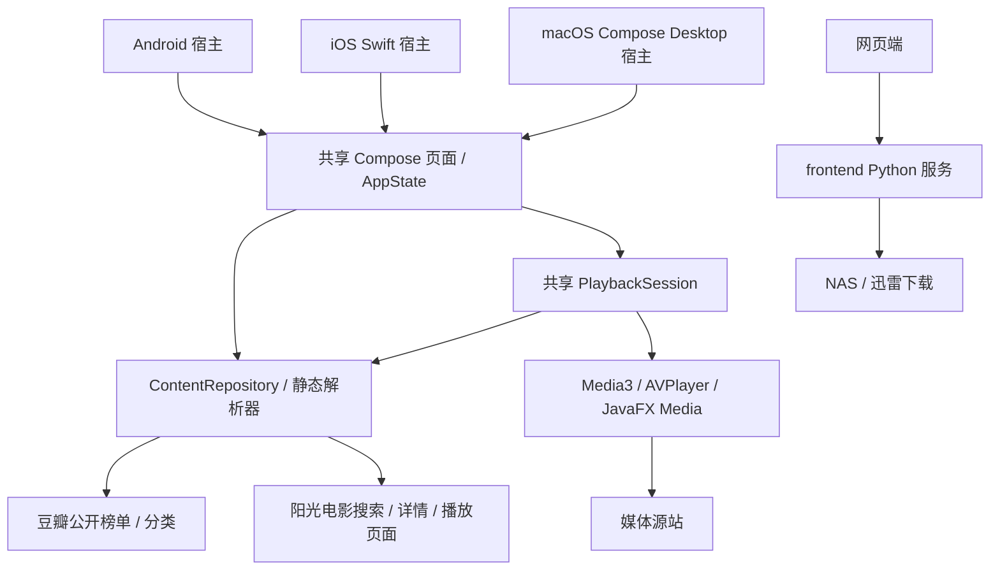

# 随心看：KMP + Compose Multiplatform 技术方案

版本：v0.3；日期：2026-11-09；目标平台：Android / iOS。

移动端应用名称已确定为“随心看”。Android/iOS 桌面名称、共享资源和我的页统一使用该名称；首页移除应用名与 slogan，为榜单内容腾出空间。工程目录、包名、Framework 和 Xcode scheme 保留原标识。

榜单和分类支持下拉刷新，以及临近列表末尾自动预加载下一页。详情内容区下拉刷新当前集和线路列表，保持播放器状态；播放会话提前解析同线路下一集，短时缓存结果供选集与连播复用。预加载失败不影响当前播放，退出详情页取消请求；媒体仍由原生播放器直接请求。

首页顶部提供搜索框，提交后在首页展示在线播放来源结果，可按影视类型筛选并返回榜单。底部四个目的地为发现、最近热播、分类、我的；最近热播使用豆瓣热门排序，默认热播剧集，可切换热门电影，使用独立的可刷新/分页列表状态，复用已有来源获取与匹配逻辑。

用户已确认移动端独立运行方案：**榜单、分类、搜索、资源匹配与播放解析内嵌在应用中，设备直接播放媒体；NAS 下载仅由网页端提供。** 本文替代 v0.2 中依赖 Python API、配置服务地址和复制下载链接的设计。实际验证结果见 [实现与验证记录](实现与验证记录.md)。

## 1. 产品目标与边界

应用首次启动直接加载影视榜单，无需启动电脑/NAS 服务、填写 IP 或连接同一局域网。独立运行仍需要互联网访问豆瓣、搜索来源及媒体源站。

| 能力 | 移动端 | 网页端 |
| --- | --- | --- |
| 榜单、分类、搜索 | KMP 共享 Kotlin 直接获取与解析 | 保留现有 Python 实现 |
| 在线播放 | 共享资源解析 + Media3 / AVPlayer | 保留网页播放器 |
| NAS 目录、迅雷/MCP、下载任务 | 不接入、不配置、不触发 | 保留现有服务能力 |
| 私人 NAS 媒体库、离线下载、账号同步 | 不在本次范围 | 不新增 |

移动端当前接入豆瓣榜单与分类，以及**阳光电影（huolot.com）的在线播放搜索**。飘花、电影港和 66 影视目前在网站中承担下载资源搜索，移动端不移植其下载解析器。原有网页和 Python 服务不参与应用启动，也不因本次改动被移除。

共享页面为发现（含搜索）、分类、最近热播、我的、播放。我的页提供资料编辑、我的收藏与播放记录（本地持久化），替代原有服务设置页。应用不再读写旧 `server_address`，没有服务连接检查或 NAS 状态页面。搜索、详情和我的页不显示内容来源名称或原站跳转。

首页采用红果参考稿的浅色布局：薄荷渐变顶部、灰色搜索、黑色分类文字与橙色短下划线、彩色快捷入口、手机双列海报；宽度达到 600dp / 840dp 时分别三列 / 四列。54dp 半透明白色导航选中黑色，其他页面共用浅色主题与橙色强调。设计 token 未完整取得，部分色值由 Figma 截图近似还原。

## 2. 技术栈与工程

以已经联合编译的版本为准，版本集中在 `gradle/libs.versions.toml`：

| 项目 | 当前基线 |
| --- | --- |
| Kotlin / Compose Compiler | 2.4.21 |
| Compose Multiplatform | 1.10.3 |
| AGP / Gradle / JDK | 9.1.0 / 9.3.1 / 21 |
| Ktor / Navigation / Coil | 3.3.3 / 2.9.2 / 3.3.0 |
| Media3 | 1.9.3 |
| Android | minSdk 26，compileSdk 36 |
| iOS | 最低 iOS 15；iosArm64 / iosSimulatorArm64 |

首版手动构造依赖。共享模块使用 Google Android-KMP 库插件；ChinaDebug / ChinaRelease 变体由 `app` 宿主管理。iOS 使用 SwiftUI 宿主嵌入 ComposeUIViewController，Xcode Build Phase 构建静态 Framework，不依赖 CocoaPods。

```text
PandaVideo/
├── frontend/                         # 网页、Python 服务及 NAS 下载
└── mobile/
    ├── app/                          # Android 入口、Manifest、图标
    ├── desktop/                      # Compose Desktop（JVM）入口、窗口与 dmg 打包
    ├── shared/src/
    │   ├── commonMain/kotlin/dev/pandavideo/
    │   │   ├── app/                  # PandaVideoApp 导航与配置常量、AppState 页面状态
    │   │   ├── core/
    │   │   │   ├── model/            # 业务数据与分页/下一集规则
    │   │   │   ├── platform/         # 网络工厂、存储、全屏、画面 expect 契约
    │   │   │   └── player/           # 原生播放器契约与共享播放会话
    │   │   ├── data/
    │   │   │   ├── html/             # 有界静态 HTML 读取
    │   │   │   ├── repository/       # 直连网络、榜单、搜索、匹配、播放解析
    │   │   │   └── user/             # 收藏、播放记录与资料的本地持久化
    │   │   └── ui/                   # catalog/common/player/profile/search 各屏 Compose UI
    │   ├── androidMain/.../core/platform/   # OkHttp、Media3、PlayerView、SharedPreferences
    │   ├── iosMain/.../core/platform/       # Darwin、AVPlayer、AVKit、NSUserDefaults
    │   ├── jvmMain/.../core/platform/       # OkHttp、JavaFX Media（JFXPanel）、Preferences、AWT
    │   └── commonTest/               # 网络 fixture、解析、状态/播放/导航/用户存储测试
    ├── iosApp/                       # Xcode 工程、Swift、Info.plist、图标
    └── docs/
```



## 3. 内容仓库与来源解析

### 3.1 网络生命周期

`AppState` 持有一个 `ContentRepository`，仓库接收平台创建的 Ktor HttpClient。Android 使用 OkHttp，iOS 使用 Darwin；公共逻辑不引用 JVM、UIKit 或 Python 类型。退出共享应用时取消请求、释放播放器并关闭 HTTP Client。

请求使用浏览器 User-Agent 和来源 Referer，保留 HTTPS 的 TLS 证书验证。两端禁用 Ktor 自动重定向，由仓库最多跟随四次 HTTP/HTTPS 跳转；允许更换域名及使用非标准端口，拒绝非 Web 协议和带凭据的地址。HTML/JSON 响应最多读取 2 MiB，请求预算 15 秒；用户取消继续传播，不映射成网络错误。不输出完整媒体 URL、签名参数。

不注入 Cookie、不执行页面 JavaScript、不启动 WebView、不处理需站点授权或 DRM 的资源。需要额外授权的播放配置通过中文错误提示交给用户在原站处理。

### 3.2 榜单与分类

| 能力 | 直连入口与规则 |
| --- | --- |
| Top 250 | `https://movie.douban.com/top250?start=…`，读取 item 卡片、标题、subject URL、评分、年份、海报 |
| 高分剧集、喜剧、动画、自然 | 转为共享分类查询，按评分排序 |
| 分类 | `/j/new_search_subjects`，传入 sort、range、tags、start、可选 year_range |
| 海报 | 直接使用有效 HTTP(S) 图片地址，携带 User-Agent/来源 Referer；加载中、缺失或失败时显示居中的默认海报图标，片名仅显示在海报外 |

Top 250 每页 25 条、最大偏移 225；分类每页 20 条，`hasMore` 按上游原始条目数量计算，不能因过滤无评分条目误判分页。分页按作品 subject URL 去重。类型、题材、国家/地区、年份或排序变化取消旧请求并重置结果。国家/地区使用共享稳定键映射到豆瓣标签，默认为全部地区，按筛选后的完整请求地址分别缓存。

应用维护最多 64 页会话内缓存；每次刷新/加载重新请求来源，失败且有相同页缓存时标记 stale 并展示缓存。缓存不落盘，重启后离线不能恢复榜单。挑战页/格式异常不会被当成合法空列表。

### 3.3 搜索

直连 `https://huolot.com/vodsearch/-------------.html?wd=…`。电影/剧集过滤分别使用 `tid=1/2`，同时核对卡片分类。关键词去书名号，合并相邻汉字间空格，长度为 1–160 字。

仅提取 `stui-vodlist__media` 搜索列表内 `v-thumb` 卡片，排除导航推荐、重复项、非本站和非详情地址。展示标题、可用海报和观看入口，最多八条结果；来源与详情地址仅用于内部解析。站点验证页、超时、HTTP 失败与合法零结果分别呈现。

`SearchItem` 保存稳定的详情页和来源标识。没有服务签发令牌、30 分钟过期机制或下载按钮。

### 3.4 榜单播放匹配

按标题搜索，使用忽略标点和大小写的精确标题规则筛选。有年份时核对详情页年份，并验证候选可解析播放；缺少年份时只有唯一标题候选才自动匹配。多个符合条件的来源条目不自动猜选，回到搜索交给用户选择。

匹配结果不做跨会话持久化，媒体签名地址每次重新解析；来源失败不缓存成永久“无资源”。

### 3.5 播放解析

仅接受 `huolot.com` HTTPS 的 `/voddetail/<id>.html` 和 `/vodplay/<id>-<line>-<episode>.html`，拒绝凭据、查询参数、片段、其他路径和域名。

详情页提取同一影片 ID 的剧集链接，按页面顺序和线路保留，去重后用正式剧集标签覆盖“立即播放”。所选剧集必须存在于当前列表。

播放页静态读取 `var player_* = {…}` JSON 对象，正确识别字符串转义与嵌套对象的结束位置，不执行脚本。`encrypt=0/1/2` 分别读取原文、URL 解码、Base64 + URL 解码；未知加密与无效数据报错。非零 points/trysee 配置拒绝内置播放。

只接收有效 HTTP(S) 媒体地址：`.m3u8` 为 HLS，`.mp4/.webm/.ogg/.m4v/.mov` 为视频候选。候选格式能否实际播放仍取决于平台编解码器和媒体站点，不承诺 Android/iOS 对所有扩展名具有一致支持。

## 4. 状态、导航与播放器

共享单向数据流使用 CoroutineScope、StateFlow 和 Compose 导航。AppState 初始化即加载发现榜单，搜索、分类、匹配各自持有可取消 Job，新请求不允许旧结果覆盖。请求取消异常继续传播，其他错误转成中文状态。

`PlaybackSession` 管理解析、重试、选集、媒体编号和同线路下一集。旧解析结果、迟到播放结束事件和重复结束事件不能跳过新剧集。退出播放释放原生控制器；横屏或界面重组只调整画面承载，不重建会话。

| 分工 | Android | iOS |
| --- | --- | --- |
| 播放与画面 | Media3 ExoPlayer、HLS、PlayerView | AVPlayer、AVPlayerViewController |
| 控制 | 播放、暂停、拖动、倍速 | 播放、暂停、拖动、倍速 |
| 全屏 | 横屏与系统栏隐藏 | 共享画面扩展、用户旋转及 AVKit 全屏 |
| 后台 | 暂停，音频焦点/耳机处理 | 暂停，AVAudioSession |
| 退出 | 解绑监听与 release | 清空 item、移除观察器、暂停 |

资源解析失败可重新解析或切换线路，页面不提供原站跳转。首版未加入画中画、投屏、观看历史、收藏、离线媒体、自动账号登录或 NAS 本地文件串流。

## 5. 构建与验收

所有本机 Gradle/Xcode 构建经 `iosApp/build-shared.sh` 读取相同 `.xcode.env`，避免 Kotlin/Native 两套缓存造成重复平台库。JDK 21、Android SDK、Gradle/Konan 缓存为本机配置，不提交凭据或签名文件。

```sh
/bin/sh mobile/iosApp/build-shared.sh :shared:testAndroidHostTest \
  :app:assembleChinaDebug :app:lintChinaDebug
/bin/sh mobile/iosApp/build-shared.sh :app:installChinaDebug
/bin/sh mobile/iosApp/build-shared.sh :shared:linkDebugFrameworkIosSimulatorArm64 \
  :shared:linkDebugFrameworkIosArm64
```

验收区分：纯解析与 MockEngine 测试、Android/iOS 编译、设备安装启动、真实来源访问、原生播放。MockEngine 只替换测试请求，不给正式应用注入模拟内容或服务地址。

必测范围包括首次启动无配置、搜索类别与推荐隔离、榜单分页、缓存失效提示、取消传播、跨站跳转跟随及循环上限、非法页面拒绝、加密 JSON、授权拒绝、选集和连播。真实站点的验证码、地区限制、临时故障或媒体签名失效需记录实际结果，不能用测试样片代替真实来源可用性结论。

iOS Info.plist 必须保留 `CADisableMinimumFrameDurationOnPhone=true`。真机签名由 Xcode Personal Team/开发证书处理，模拟器编译与启动不等同真机签名成功。

双端图标沿用网站绿色播放设计，生成方法见 [README](../README.md)。网页仍可单独通过仓库根目录 `./frontend/run.sh` 启动，其 NAS 下载流程保持原实现。
